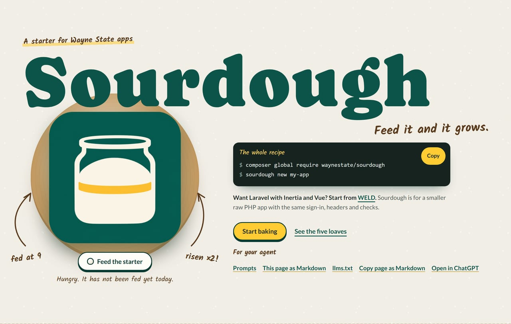
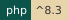
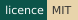
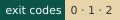
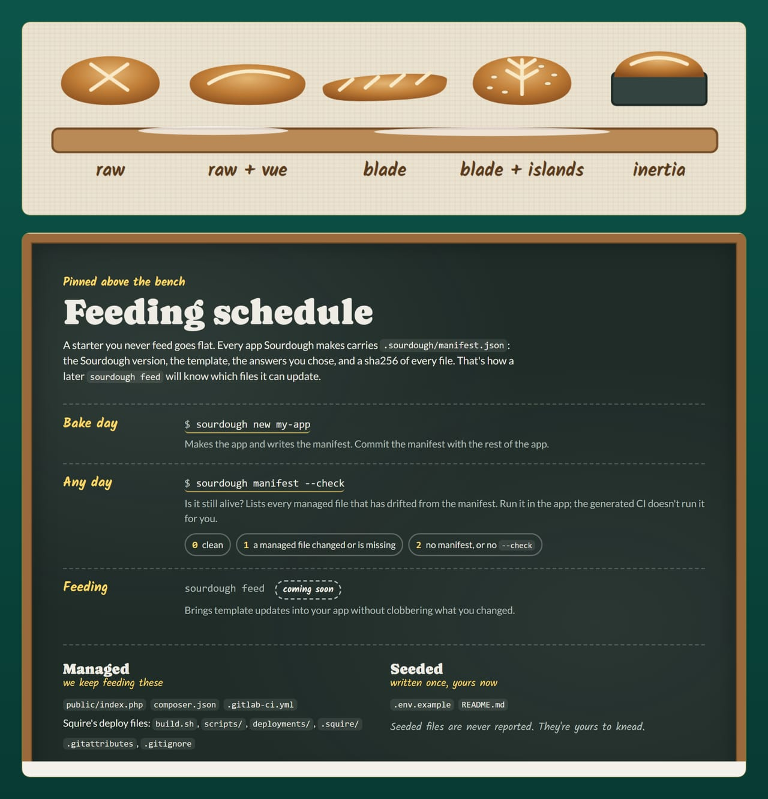
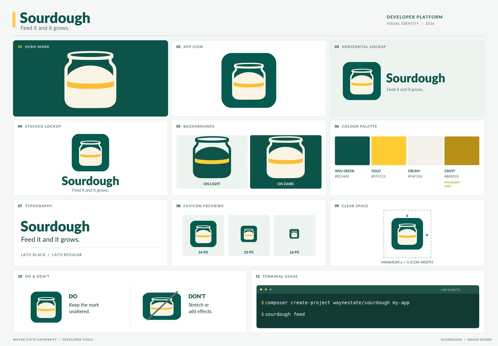

<div align="center">

[](site/index.html)

# SOURDOUGH

   [](https://github.com/waynestate/sourdough/actions/workflows/ci.yml)

**Feed it and it grows.**

</div>

A starter you feed: `sourdough new` makes a Wayne State app with the stack already wired in.

Checks: `composer ci` (the same command runs on GitLab and GitHub).

Every loaf gets proofed before it ships.

Front page: [`site/index.html`](site/index.html), a static page you can open in a browser or serve from `site/`.

On Citadel it is served by the raw-PHP deploy layer in [`deploy/`](deploy/): a SQUIRE kit whose front controller serves `site/` behind HELMET's security headers. For local development, keep serving `site/` directly.

This repository is published from Wayne State University's internal GitLab and mirrored here. Changes land there first; Wayne State developers open issues and merge requests on the internal project.

Sourdough is the app starter for the WSU stack. One command scaffolds a new app with SESAME (auth), HELMET (baseline runtime), PROCTOR (checks), and the PREFLIGHT CI components already in place. It is one PHP command, so it works on Windows, macOS, and Linux.

<div align="center">



<sub>The proofing log from the front page: what goes into the tub when you run <code>sourdough new</code>, and the day-to-day check that keeps it alive.</sub>

</div>

## Install

```
composer global require waynestate/sourdough
```

Or scaffold without installing, with `composer create-project waynestate/sourdough`.

## Usage

```
sourdough new [dir] [options]
```

`dir` is the directory to create the app in. It is required unless you use `--describe`.

Options:

- `--raw` use the raw PHP base
- `--laravel` use the Laravel base
- `--vue` add a Vue front end
- `--inertia` use Inertia (Laravel only)
- `--sail` use Laravel Sail for the local runtime (Laravel paths)
- `--docker` use a Docker image for the local runtime (Laravel paths)
- `--dry-run` print the plan and write nothing
- `--name` app name (default: the basename of `<dir>`)
- `--no-input` never prompt (Sourdough 0.1 has no prompts)
- `--json` with `--dry-run`, print the plan as JSON
- `--describe "<sentence>"` describe what the app does; a model plans it (needs the `SOURDOUGH_LLM_*` env vars)
- `--plan-only` with `--describe`, print the plan as JSON and write nothing
- `--plan <file>` a ready-made plan file (JSON matching `resources/plan.schema.json`)
- `--playbook` require `waynestate/playbook` in the generated app: adds the VCS repository and the package to `require`
- `--no-playbook` skip the PLAYBOOK wiring (no `suggest`, no `.env.example` block, no README section)

Exit codes: `0` done, `1` refused (invalid flags, non-empty target, not available, model gave up), `2` tool error.

By default the generated app suggests `waynestate/playbook` (WSU's private shared-values package on git.wayne.edu), lists its seven setting names in `.env.example`, and documents how to fetch them in a "WSU values (PLAYBOOK)" README section; the command prints a hint line pointing at it after generation. `--playbook` additionally adds the VCS repository and requires the package; `--no-playbook` skips all of it. The two flags together are refused with exit `1`.

The app name (from `--name`, from the plan, or from the basename of `<dir>`) must start with a letter or number and use only letters, numbers, spaces, dots, dashes and underscores, at most 63 characters; anything else is refused before anything is written.

## Permutations

| Flags | Permutation |
|---|---|
| (none) or `--raw` | Raw PHP with WayneUI's standalone path |
| `--raw --vue` | Raw PHP + Vue SPA over JSON |
| `--laravel` | Laravel + Blade |
| `--laravel --vue` | Laravel + Blade + Vue islands |
| `--laravel --inertia` | Laravel + Inertia/Vue |

Only `--raw` generates in 0.1. The other permutations print the plan and exit `1` with "not available in this release"; later steps add them.

## Describe a plan

Instead of choosing flags, describe what the app does and let a model plan it:

```
sourdough new --describe "A blog with posts and comments"
```

Sourdough asks an OpenAI-compatible model for a plan, validates it against `resources/plan.schema.json`, and prints it. The model kneads the dough, but you decide when the loaf is ready to bake: if the answer is not valid JSON, does not match the schema, or the model gives up after one retry, Sourdough refuses with a message pointing you to `--plan=<file>` (exit `1`). You write the plan yourself and pass it in.

To see the plan as JSON without writing anything:

```
sourdough new --describe "A blog with posts and comments" --plan-only
```

Generation from a plan is not built yet in 0.1. Save the plan to a file and pass it with `--plan`:

```
sourdough new my-app --plan plan.json
```

`--plan` reads the file, validates it against the schema, and continues the normal generation flow using the plan's permutation and name.

### Model configuration

`--describe` needs three environment variables (no defaults, no key in code):

- `SOURDOUGH_LLM_BASE_URL` the OpenAI-compatible endpoint, including the API path (usually `/v1`)
- `SOURDOUGH_LLM_API_KEY` the API key
- `SOURDOUGH_LLM_MODEL` the model name

Any OpenAI-compatible endpoint works: a hosted API, a local server, or WarriorGPT. Sourdough does not care about the hostname; it only needs the base URL, key, and model.

A plan is a small JSON object:

```json
{
    "permutation": "raw",
    "parts": ["sesame", "helmet"],
    "name": "my-app",
    "models": [
        {
            "name": "Post",
            "fields": [
                { "name": "title", "type": "string" },
                { "name": "body", "type": "text" }
            ]
        }
    ],
    "pages": ["/", "/posts"]
}
```

`permutation`, `parts`, and `name` are required; `models` and `pages` are optional. `parts` is a subset of `sesame`, `helmet`, `proctor`, and `preflight`.

## The manifest

Every app Sourdough generates carries a `.sourdough/manifest.json` recording what was generated: the Sourdough version, the template, the answers you chose, and a sha256 hash of every file, each marked `managed` (Sourdough owns it and will update it) or `seeded` (Sourdough wrote it once and you own it now: `.env.example` and `README.md`).

The manifest is the starter's memory: it remembers what went into the loaf, so `feed` knows what to refresh and what to leave to rise on its own. A later `sourdough feed` reads it to bring template updates into your app without clobbering what you've changed.

Until `feed` ships, `sourdough manifest --check` is the gate. Run it in your app to list the managed files that have drifted from the manifest:

```
sourdough manifest --check
```

Exit codes: `0` clean, `1` a managed file changed or is missing, `2` tool error (no manifest, or no `--check`). Seeded files are never reported. They're yours.

Commit the manifest. It's the record that keeps `feed` honest.

The deploy files in your app (`build.sh`, `scripts/release.sh`, the `.squire/` config, and their friends) come from SQUIRE's exported copy, checked into this repository at `templates/squire/`. SQUIRE owns them; Sourdough installs them as-is and records them in the manifest, so you never edit them by hand. To refresh them, run `composer squire-copy:sync`, which rewrites the copy from the installed `waynestate/squire` package, then verify it with `composer squire-copy:check` (part of `composer ci`).

## Testing

Maintainers: how to build, test and release this project, and where its data comes from, is in [MAINTAINING.md](MAINTAINING.md).

From the repo root:

```
docker run --rm -v "${PWD}:/app" -w /app composer:2 composer install --no-interaction
docker run --rm -v "${PWD}:/app" -w /app php:8.3-cli vendor/bin/phpunit
docker run --rm -v "${PWD}:/app" -w /app php:8.4-cli vendor/bin/phpunit
docker run --rm -v "${PWD}:/app" -w /app composer:2 composer validate --strict
docker run --rm -v "${PWD}:/app" -w /app php:8.4-cli php bin/sourdough new /tmp/demo --dry-run
```

## CI

Strongly recommended: a git.wayne.edu instance runner.

<details>
<summary>On the bench: the five loaves and the feeding schedule</summary>



</details>

<details>
<summary>The recipe card: Sourdough's brand board</summary>



</details>

<div align="center">

## Same kitchen, many ovens

<a href="https://github.com/waynestate/wayne-ui"></a>
<a href="https://github.com/waynestate/creed"></a>
<a href="https://github.com/waynestate/proctor"></a>
<a href="https://github.com/waynestate/sesame"></a>
<a href="https://github.com/waynestate/helmet"></a>
<a href="https://github.com/waynestate/sourdough"></a>
<a href="https://github.com/waynestate/squire"></a>
<a href="https://github.com/waynestate/preflight"></a>
<a href="https://github.com/waynestate/pinstripe"></a>
<a href="https://github.com/waynestate/booster"></a>
<a href="https://github.com/waynestate/rollcall"></a>
<a href="https://github.com/waynestate/drawbridge"></a>
<a href="https://github.com/waynestate/advisor"></a>
<a href="https://github.com/waynestate/weld"></a>

<sub>Sourdough is one of the parts. Feed it, and it grows; just do not leave it on the counter over a long weekend.</sub>

</div>
