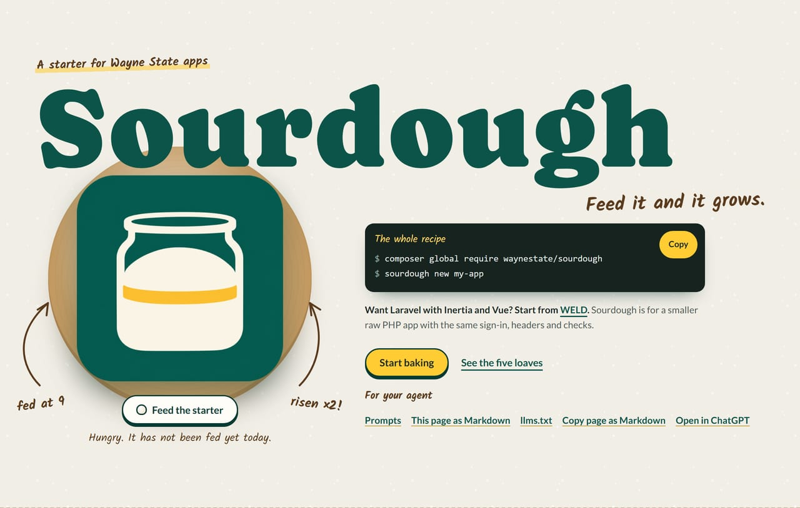
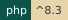
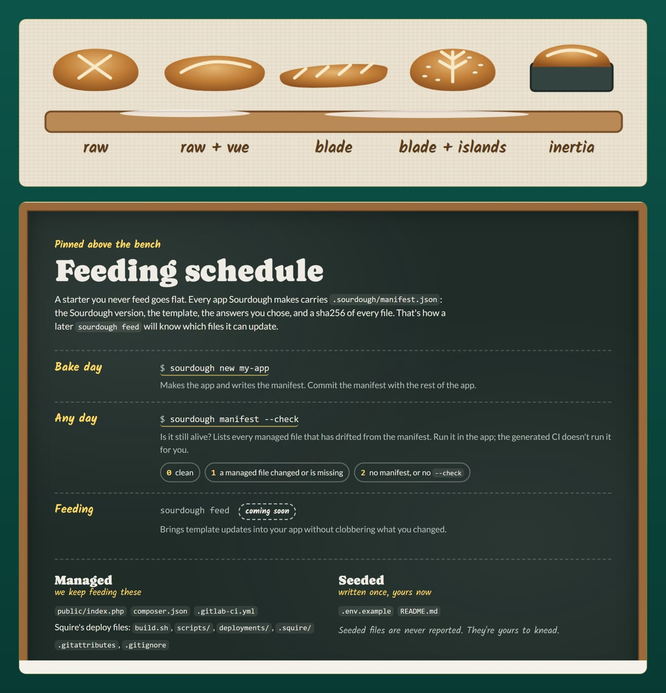
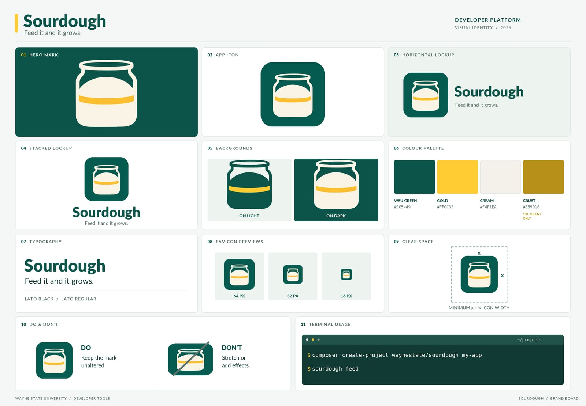

<div align="center">

[](site/index.html)

</div>

<!-- The title stays outside the centered block: the agent-ready kit drops HTML blocks and names
     llms.txt after the README's first top-level heading. -->
# Sourdough

<div align="center">

   [](https://github.com/waynestate/sourdough/actions/workflows/ci.yml)

</div>

**Feed it and it grows.**

A starter you feed: `sourdough new` makes a Wayne State app with the stack already wired in.

Checks: `composer ci` (the same command runs on GitLab and GitHub).

Status: 0.4.2 (2026-11-09), MIT license: Pinstripe 0.3 in every shape (an app that joins SQL from strings fails PHPStan until it binds values instead), Pint's findings in the merge request widget on the Laravel shapes, a "Run it like Citadel" README section in every shape for [Parity](https://git.wayne.edu/enterprise-apps/parity), and `sourdough adopt` for apps Sourdough did not make. What changed is in the [changelog](CHANGELOG.md); what a feed brings is in [Upgrading](docs/upgrading.md).

Every loaf gets proofed before it ships.

Documentation: the [docs site](site/docs/index.html) is built from [`docs/`](docs/) by Squire's docs builder; `composer docs:build` rebuilds it and `composer docs:check` fails when it is stale. The docs pages wear the front page's header, menu, palette and fonts: edit [`docs/_header.html`](docs/_header.html) and [`docs/theme/sourdough.css`](docs/theme/sourdough.css) (named by the `theme` key in `docs/docs.json`), never the kit's `docs.css`.

Front page: [`site/index.html`](site/index.html), a static page you can open in a browser or serve from `site/`. Its order counter writes the `sourdough new` command for a loaf, an oven and a name, with the bake and the next steps, all read from [`site/assets/order-menu.json`](site/assets/order-menu.json), and copies a link that reopens the same order (`#order?loaf=...&oven=...`). `composer site:order-menu` writes that file from the same plan code `sourdough new --dry-run --json` runs, `composer ci` fails when it is stale, and `tests/OrderMenuTest.php` runs every order the ticket can write through the real command.

On Citadel it is served by the raw-PHP deploy layer in [`deploy/`](deploy/): a Squire kit whose front controller serves `site/` behind HELMET's security headers. For local development, keep serving `site/` directly.

## Where the code lives

The canonical repository is [enterprise-apps/sourdough](https://git.wayne.edu/enterprise-apps/sourdough) on git.wayne.edu. Open issues and merge requests there; tags are made there, by the maintainer, with an approver. GitHub ([waynestate/sourdough](https://github.com/waynestate/sourdough)) is a read-only push mirror of it: nobody pushes to it, and Packagist reads from it. git.wayne.edu is the starter culture now; GitHub is the slice Packagist eats.

Sourdough is the app starter for the WSU stack, and it starts every app shape: raw PHP, raw PHP with a Vue SPA, Laravel with Blade, Laravel with Blade and Vue islands, and Laravel with Inertia and Vue. WELD is that last shape already built from it. One command scaffolds a new app with WayneUI (the interface), SESAME (auth), HELMET (baseline runtime), Pinstripe (coding standard), PROCTOR (checks), the Preflight CI components, Squire's deploy files and ADVISOR (the stack's MCP server) already in place, with its PHP floor read from CREED's policy. It is one PHP command, so it works on Windows, macOS, and Linux.

<div align="center">



<sub>The proofing log from the front page: what goes into the tub when you run <code>sourdough new</code>, and the day-to-day check that keeps it alive.</sub>

</div>

## Install

```
composer global require waynestate/sourdough
```

After `composer global require`, the `sourdough` command lives in `composer global config bin-dir --absolute`; put that directory on your PATH.

Or scaffold without installing, with `composer create-project waynestate/sourdough`.

## Usage

```
sourdough new [dir] [options]
```

`dir` is the directory to create the app in. It is required unless you use `--describe`.

Options:

- `--raw` use the raw PHP base
- `--laravel` use the Laravel base
- `--vue` add a Vue front end
- `--inertia` use Inertia/Vue (implies `--laravel`)
- `--sail` run the Laravel app on Sail for local work: compose.yaml and laravel/sail in require-dev, MySQL 8.4 LTS; needs WSL2 on Windows, where `--docker` is the route that works natively
- `--docker` generate a Dockerfile and compose.yaml for local work (native on every OS; amd64 and arm64): the app's own base images, pinned by digest, for everyday work (Citadel's own image and MySQL 5.6.51 are [Parity](https://git.wayne.edu/enterprise-apps/parity)'s job: every baked README's "Run it like Citadel" says how); MySQL 8.4; Playbook credentials reach the build only as a BuildKit secret, never a build arg
- `--dry-run` print the plan and write nothing
- `--name` app name (default: the basename of `<dir>`)
- `--no-input` never prompt (Sourdough has no prompts)
- `--json` with `--dry-run`, print the plan as JSON, with the bake's `steps` and the `next_steps` a real run prints
- `--describe "<sentence>"` describe what the app does; a model plans it (needs the `SOURDOUGH_LLM_*` env vars)
- `--plan-only` with `--describe`, print the plan as JSON and write nothing
- `--plan <file>` a ready-made plan file (JSON, or YAML ending in `.yaml` or `.yml`, matching `resources/plan.schema.json`), such as the `.sourdough/plan.yaml` every bake saves
- `--playbook` kept for compatibility: Playbook is now the default
- `--no-playbook` skip the Playbook wiring (for CI and automated tests only; WSU apps need Playbook)
- `--no-advisor` skip the ADVISOR wiring (no `require-dev` entry, no `.mcp.json` git-ignore line of its own, no README section; the Laravel shapes still ignore `/.mcp.json` for Laravel Boost)

Exit codes: `0` done, `1` refused (invalid flags, non-empty target, not available, model gave up), `2` tool error.

By default the generated app requires `waynestate/playbook` (WSU's private shared-values package on git.wayne.edu): the VCS repository, the package in `require`, `config.gitlab-domains` so Composer sends your token to git.wayne.edu, the seven setting names in `.env.example`, a `composer playbook` script that shows whether Playbook is installed, and a "WSU values (PLAYBOOK)" README section that explains how to get read access. Before writing anything, `sourdough new` checks that this machine can read the package (a Composer credential, then a direct git probe); without read access it refuses with exit `1` and prints the how-to, and if it cannot reach git.wayne.edu it still generates the app but warns that `composer install` will need the connection. Non-interactive runs and CI environments skip the check. `--dry-run` runs the check but never refuses, and its JSON plan carries a `playbook` key with the mode, the access status and the probe that answered. After generation the Next steps point at `composer playbook`. `--playbook` is kept for compatibility and changes nothing; `--no-playbook` skips all of it. The two flags together are refused with exit `1`.

Generated apps ship with ADVISOR wired in by default: `waynestate/advisor` lands in `require-dev`, `.mcp.json` is git-ignored (a client config starts a program for whoever opens the project), and the README gains an "ADVISOR" section. The Next steps print the install line once dependencies are in:

```
php vendor/bin/advisor install --client=claude --write
```

`--no-advisor` skips all of it.

The three Laravel shapes also ship Laravel Boost as a dev-only tool, whatever the ADVISOR answer: `laravel/boost` in `require-dev`, a guarded `composer boost-update` after `composer update`, a `.gitignore` block for what `php artisan boost:install` writes (`/.mcp.json`, `/boost.json`, `/CLAUDE.md`, `/AGENTS.md`, `/.claude/skills/`, `/.junie/`), the stack's guidelines and two starter rules in `.ai/`, and `tests/Feature/BoostDevOnlyTest.php`. ADVISOR complements Boost: Boost knows Laravel, ADVISOR knows the stack. See [Laravel Boost, dev only](docs/guides/laravel.md#laravel-boost-dev-only).

The app name (from `--name`, from the plan, or from the basename of `<dir>`) must start with a letter or number and use only letters, numbers, spaces, dots, dashes and underscores, at most 63 characters; anything else is refused before anything is written.

## Permutations

| Flags | Permutation |
|---|---|
| (none) or `--raw` | Raw PHP with WayneUI's standalone path |
| `--raw --vue` | Raw PHP + Vue SPA over JSON |
| `--laravel` | Laravel + Blade |
| `--laravel --vue` | Laravel + Blade + Vue islands |
| `--laravel --inertia` (or `--inertia`) | Laravel + Inertia/Vue |

All five permutations bake: raw PHP since 0.1.0, the three Laravel shapes since 0.1.5 and raw PHP + Vue since 0.1.6. `--raw --vue` is the raw PHP bake with a Vue 3 front end over it: PHP answers JSON under `/api/`, Vite builds the Vue app, and `src/Vite.php` loads it from the build or the dev server.

Every bake takes its PHP floor from CREED's policy, not from a number baked into the template: the oldest PHP line still supported a year after the policy's refresh date (raised to what the Laravel major needs) becomes `require.php`, `config.platform.php` and the start of the CI test matrix. If the policy cannot be read, the bake falls back to the pinned `^8.3` and says so. `sourdough new` prints both a `PHP:` line and a `Support:` line, and every shape has an owner, a support window and a sunset path, so no starter goes stale on the counter. The rules are in [Support and sunset](docs/guides/support.md).

Oracle is wired but dormant in every generated app. The settings `ORACLE_USERNAME`, `ORACLE_PASSWORD`, and either `ORACLE_TNS` or `ORACLE_HOST`, `ORACLE_PORT`, `ORACLE_SERVICE_NAME` ship commented out in `.env.example`; while they are empty, nothing connects and nothing errors. Once you fill them in, Laravel apps check the wiring with `php artisan oracle:check`, and raw PHP apps run queries through the `App\Oracle` helper, which takes values only as binds and answers mistakes with plain sentences. The Laravel shapes require `yajra/laravel-oci8` and declare `ext-oci8` 3.4.1 as a platform package, so the driver is ready the day the settings are filled in: most WSU apps need Oracle, and Citadel's images carry oci8 and Instant Client. The command finds the check file where it lives: `oracle-check.php` at the app root, where Squire's Laravel layout ships it, first, then `deploy/oracle-check.php`.

## Describe a plan

Instead of choosing flags, describe what the app does and let a model plan it:

```
sourdough new --describe "A blog with posts and comments"
```

Sourdough asks an OpenAI-compatible model for a plan, validates it against `resources/plan.schema.json`, and prints it. The model kneads the dough, but you decide when the loaf is ready to bake: if the answer is not valid JSON, does not match the schema, or the model gives up after one retry, Sourdough refuses with a message pointing you to `--plan=<file>` (exit `1`). You write the plan yourself and pass it in.

To see the plan as JSON without writing anything:

```
sourdough new --describe "A blog with posts and comments" --plan-only
```

`--describe` stops at the plan: baking straight from a description is not built yet. Save the plan to a file and pass it with `--plan`, which bakes it:

```
sourdough new my-app --plan plan.json
```

`--plan` reads the file, validates it against the schema, and continues the normal generation flow using the plan's permutation and name. A file ending in `.yaml` or `.yml` is read as YAML; anything else as JSON.

Every bake saves its plan in the app as `.sourdough/plan.yaml`: the recipe card taped inside the jar's lid. A `--plan` bake saves that plan (with `--name`, if you gave one); a bake from flags saves the shape, the name and all four parts. The card is a valid plan file, so `sourdough new other-app --plan=my-app/.sourdough/plan.yaml` bakes the same loaf again. See [Plan format](docs/reference/plan-format.md#the-saved-plan).

### Model configuration

`--describe` needs three environment variables (no defaults, no key in code):

- `SOURDOUGH_LLM_BASE_URL` the OpenAI-compatible endpoint, including the API path (usually `/v1`)
- `SOURDOUGH_LLM_API_KEY` the API key
- `SOURDOUGH_LLM_MODEL` the model name

Any OpenAI-compatible endpoint works: a hosted API, a local server, or WarriorGPT. Sourdough does not care about the hostname; it only needs the base URL, key, and model.

A plan is a small JSON object:

```json
{
    "permutation": "raw",
    "parts": ["sesame", "helmet"],
    "name": "my-app",
    "models": [
        {
            "name": "Post",
            "fields": [
                { "name": "title", "type": "string" },
                { "name": "body", "type": "text" }
            ]
        }
    ],
    "pages": ["/", "/posts"]
}
```

`permutation`, `parts`, and `name` are required; `models` and `pages` are optional. `parts` is a subset of `sesame`, `helmet`, `proctor`, and `preflight`.

## The manifest

Every app Sourdough generates carries a `.sourdough/manifest.json` recording what was generated: the Sourdough version, the template, the answers you chose, and a sha256 hash of every file, each marked `managed` (Sourdough owns it and will update it) or `seeded` (Sourdough wrote it once and you own it now: `.env.example`, `README.md`, and `package-lock.json` on the shapes with a front end). An app `sourdough adopt` took in has a third class, `yours`: a file that differed from the template on adoption day, which you own and feed takes over once it matches the template.

The manifest is the starter's memory: it remembers what went into the loaf, so `feed` knows what to refresh and what to leave to rise on its own. `sourdough feed` reads it to bring template updates into your app without clobbering what you've changed.

`sourdough manifest --check` lists the managed files that have drifted from the manifest:

```
sourdough manifest --check
```

Exit codes: `0` clean, `1` a managed file changed or is missing, `2` tool error (no manifest, or no `--check`). Seeded and yours files are never reported. They're yours.

Commit the manifest. It's the record that keeps `feed` honest.

Next to it sits `.sourdough/plan.yaml`, the plan the app was baked from. It is not in the manifest, so it is neither managed nor seeded: `feed` and `manifest --check` never read, rewrite or flag it, and you may edit it as the app grows. Commit it too.

## Feeding an app

`sourdough feed` brings template updates into an app made with `sourdough new` (or taken in with `sourdough adopt`, below), without clobbering what you've changed. Install the new Sourdough, then, in the app, on a clean git tree:

```
sourdough feed --dry-run
sourdough feed
```

Feed bakes your app's shape again with the answers in its manifest, then goes file by file:

- a file the template did not change is left alone, whatever you did to it;
- a managed file you never touched takes the template's new version;
- a file you both changed is three-way merged by git (`git merge-file`), from the version Sourdough wrote last time; where you both changed the same lines, git's conflict markers go in the file (`<<<<<<< app` and `>>>>>>> sourdough <version>`), never a silent overwrite;
- new template files are added, and files the template dropped are removed only if you never changed them;
- a file that already matches the template's new version is only recorded in the manifest (`record`); that is also how an app baked by 0.1.6 with `--sail` or `--docker` gets its oven into the manifest;
- seeded files (`README.md`, `.env.example`, `package-lock.json`) are never touched.

Then the manifest moves to the new base, and the template's version of each managed file you've changed is kept in `.sourdough/base/`, so the next feed can merge from it even when git history can't. Commit both.

Exit codes: `0` fed cleanly (or nothing to feed), `1` fed with conflicts to resolve, `2` tool error (no manifest, no git, a dirty tree, conflicts left from the last feed, a manifest from a newer Sourdough). With `--dry-run` nothing is written: `0` the app is fresh, `1` feeding would change files. Every shape's pipeline runs it in a `sourdough-feed` job, next to `sourdough manifest --check`: an app that falls behind its template gets a warning (never a blocked deploy), hand edits to managed files are listed, and a broken record fails the job. `--json` prints the plan for machines.

**Is my app fed, and still supported?** `sourdough check` answers both in one read-only run, the baker's poke test: the `Support:` line (the shape's status and its framework's end-of-security date), the manifest drift and whether a feed is due. Exit codes: `0` fed and supported, `1` needs attention (behind the template, a deprecated shape, or a Laravel major or PHP floor past security support), `2` tool error. Your own edits are listed and never fail it, and `--json` gives machines the same answer.

Feed needs git and nothing else: git is the merge engine and the undo button (`git restore . && git clean -fd`). The Laravel shapes bake on a fresh `laravel/laravel` skeleton, so feeding one needs Composer and the network, the same as `sourdough new`; skeleton updates arrive as template updates. The full story is in [Keeping apps current](docs/guides/keeping-current.md). A fed starter is a happy starter.

The deploy files in your app (`build.sh`, `scripts/release.sh`, the `.squire/` config, and their friends) come from Squire's exported copy, checked into this repository at `templates/squire/`. The copy is Squire 0.10.7's kit, so it ships a `.gitattributes` that pins line endings, and a Laravel release first refuses to run with no `APP_KEY` or with `APP_DEBUG` on in production (and warns when `APP_ENV` is not production), then `scripts/release.sh` asks PROCTOR's deploy gate (`proctor gate`, graded on the PHP that runs the release; `SQUIRE_PHP_RUNTIME` names another or `skip`) for a go or no-go before the frontend build and the migrations, keeps the verdict in `storage/squire/` (`SQUIRE_PROCTOR_RECORD_DIR`) as the next release's baseline, and after the optimize step restarts Laravel's long-lived processes (`php artisan reload`, or `queue:restart` and `schedule:interrupt` on an older Laravel; report only, `SQUIRE_ARTISAN_RESTART=0` turns it off). The image hardens too: the web's PHP loses its shell functions (`SQUIRE_PHP_DISABLE_FUNCTIONS` sets the list), opcache runs with production settings (`SQUIRE_OPCACHE_VALIDATE`), Apache answers `ServerTokens Prod`, and secrets can be read from `/run/secrets`. Session cookies are `SameSite=Lax` (`.squire/php.ini`), every image the kit builds from is named in full (`docker.io/library/...`) so Buildah and Podman take it, and the portable image ships the built assets without `node_modules/`. Squire owns them; Sourdough installs them as-is and records them in the manifest, so you never edit them by hand. To refresh them, run `composer squire-copy:sync`, which rewrites the copy from the installed `waynestate/squire` package, then verify it with `composer squire-copy:check` (part of `composer ci`).

## Adopting an app

**Can Sourdough look after an app it did not make?** Yes: `sourdough adopt` writes the manifest an existing app would have had if Sourdough had baked it, and `feed` takes over from there. In the app, on a clean git tree, name the shape it already is (`raw`, `raw-vue`, `laravel-blade`, `laravel-blade-vue` or `laravel-inertia`):

```
sourdough adopt --shape raw --dry-run
sourdough adopt --shape raw
git add .sourdough && git commit -m "Adopt with Sourdough 0.4.2"
sourdough feed --dry-run
```

```
sourdough adopt [<dir>] --shape <shape> [--name <name>] [--sail | --docker] [--no-playbook] [--no-advisor] [--dry-run] [--json] [-v]
```

Adopt bakes the shape fresh in a scratch folder, through the same code as `new` and `feed`, and looks at each template path in the app, and only those:

- `match`: the app's file is the template's (line endings aside), so it is `managed` and feed keeps it current;
- `yours`: the file differs, so it is recorded as `yours` and never written, merged or reported, until the day your copy equals the template's and feed records it;
- `seeded`: a file the template seeds (`README.md`, `.env.example`), yours as in every Sourdough app;
- `missing`: the app has no such file; the first feed adds it, which is how Squire's kit, the pipeline with its `sourdough-feed` job, PHPStan and Pint reach an older app.

It writes `.sourdough/manifest.json` and nothing else, and never reads a file the template does not ship. `--name` defaults to the folder's basename; a wrong name makes the files that carry it differ, and the report says so. Exit codes: `0` adopted (or a dry run printed its plan), `1` refused (a wrong or missing shape, bad oven flags, a missing folder, a manifest already there, a bad name, not a git repository, a dirty tree), `2` tool error (no git, a folder it cannot write, a failed bake). `--json` gives machines the report. For older Laravel apps, upgrade with Booster first: every hop brings more files level with the template. The whole walk-through is in [Adopt an existing app](docs/guides/adopt.md). Every starter was once somebody's leftover dough.

## Which command when

<!-- which-command-when: canonical copy in WELD docs/reference/which-command.md; edit there first, then copy word for word -->
Several stack commands sound alike (`weld:doctor`, `squire doctor`, `proctor check`) and do different jobs. Find your question in the second column and run the command beside it. The doctors look at setup, the proctor grades against policy, and the gate decides deploys: same waiting room, different appointments.

| Command | What it checks | When to run it | Where it runs |
|---|---|---|---|
| `composer ci` | **Will my pipeline pass?** The repo's own CI contract, the same command the pipeline runs: validation, the tests, Pint, PHPStan, `composer audit` and whatever checks the repo adds. | Before every push. | App repo, CI |
| `bin/weld.sh doctor` or `.\bin\weld.ps1 doctor` (both run `php artisan weld:doctor`) | **Does my WELD app hold together?** The app key, writable `storage` and `bootstrap/cache`, the database connection and pending migrations. One PASS, WARN or FAIL line each; exit 1 on a FAIL. Standards are PROCTOR's. | After `up`, when the app will not start, and after every deploy off Citadel. | App repo (in the app container), deploy host (in the app container) |
| `vendor/bin/squire doctor` | **Is my Citadel release setup right?** `build.sh`, the release scripts, the health check, script hygiene, line endings, secrets kept out of git and the local parity setup, against Squire's rules. Exit 1 on a failed rule. The lock file, audit and MySQL 5.6 checks are handed to PROCTOR. | After `squire init` or `squire update`, and before the first deploy. | App repo, CI |
| `vendor/bin/squire init --check` | **Have the files Squire wrote drifted from its templates?** Missing, outdated or edited copies. Writes nothing; exit 1 on drift. | After you upgrade Squire (then run `squire update`), and in CI. | App repo, CI |
| `vendor/bin/squire doctor oracle`, or `php artisan oracle:check` in WELD and Sourdough's Laravel apps | **Can my app reach Oracle?** The `ORACLE_*` settings, the host, the port, the `oci8` driver and the login, in plain language, printing setting names and never values. Silent when the app has no Oracle settings. | After you fill in the `ORACLE_*` settings, or when a connection fails. Squire's `release.sh` runs the same check on every release, as a report. | App repo, deploy host |
| `vendor/bin/proctor check` (`composer proctor` in WELD and Sourdough's apps) | **Does my app meet CREED's policy?** The PHP floor, Laravel, Node and MySQL end of life, the committed lock, `composer audit`, open-ended constraints, portability, MySQL 5.6 safety, overrides and the rest of its checks. Exit 1 on a FAIL. | Before you merge; the pipeline runs it too. | App repo, CI |
| `vendor/bin/proctor gate` | **May this commit deploy?** The deploy-time subset of `proctor check`, ratcheted against the last release's verdict, so a deploy that makes nothing worse goes. Exit 1 is a no-go. | At deploy time. Squire's `release.sh` calls it for you. | Deploy host |
| `sourdough manifest --check` | **Which managed files did I change since Sourdough baked my app?** Managed files that changed or are missing against `.sourdough/manifest.json`; seeded files are yours and never reported. Exit 1 on a change. | Before `sourdough feed`. | App repo, CI |
| `sourdough feed --dry-run` | **Is my app behind its Sourdough template?** The plan a feed would apply, with nothing written. Exit 1 when feeding would change files. | After you install a new Sourdough, and in CI to catch an app falling behind. | App repo, CI |
| `booster plan` | **What does my upgrade take?** The ordered PHP, Laravel and front-end hops, the dependencies that block them, and advisory PHPCompatibility and PHPStan scans. Changes nothing. | Before an upgrade, and when PROCTOR says your PHP or Laravel is past support. | App repo |
| `booster replay check` | **Does my app still answer the same after a change?** Replays the requests in `booster-replay.json` and compares the answers with the ones `booster replay record` saved. Exit 1 on a changed answer. | After an upgrade hop or a hand fix, once you have a recording. | App repo (in Docker) |
| `booster init --check` | **Are Booster's coding-tab playbooks current?** The playbooks in `.agents/skills`. Changes nothing; exit 1 when one is missing or out of date. | After you upgrade Booster, and in CI. | App repo, CI |
| `php bin/regen-check.php --generated <dir>` | **Is WELD still Sourdough's Inertia shape?** WELD, file by file, against a fresh `sourdough new --inertia`; fails only on drift that `.sourdough/regen-baseline.json` does not already accept. | When Sourdough's Inertia shape or WELD changes. | WELD repo, CI |
| `rollcall report` | **Where does the whole fleet stand?** The latest scan's totals against CREED's policy: PHP, Laravel, the auth package, PROCTOR results and the end-of-life burn-down. Exit 0, or 2 on a tool error (no scan yet, a bad option, an unreadable policy); it never gates. | After `rollcall scan`, on the scan's schedule. | CI (a scheduled scan job) |
<!-- /which-command-when -->

The canonical copy of this table is in WELD's docs: [Which command when](https://weld.apps.wayne.edu/docs/reference/which-command.html).

## Testing

Maintainers: how to build, test and release this project, and where its data comes from, is in [MAINTAINING.md](MAINTAINING.md).

From the repo root:

```
docker run --rm -v "${PWD}:/app" -v stack-composer-cache:/tmp/cache -w /app composer:2.11.1@sha256:8de2184c6de224f4689e8f80ed5f5edaf0030b6b8b7839a22a2bcb6722ac87d0 composer install --no-interaction
docker run --rm -v "${PWD}:/app" -w /app php:8.3-cli vendor/bin/phpunit
docker run --rm -v "${PWD}:/app" -w /app php:8.4-cli vendor/bin/phpunit
docker run --rm -v "${PWD}:/app" -v stack-composer-cache:/tmp/cache -w /app composer:2.11.1@sha256:8de2184c6de224f4689e8f80ed5f5edaf0030b6b8b7839a22a2bcb6722ac87d0 composer validate --strict
docker run --rm -v "${PWD}:/app" -w /app php:8.4-cli php bin/sourdough new /tmp/demo --dry-run
```

The `stack-composer-cache` volume keeps Composer's downloads between runs; Docker creates it the first time. The smoke gate bakes a shape for real and runs the generated app's own checks; see the "Smoke gate" section of [MAINTAINING.md](MAINTAINING.md) for the full recipe. On Windows, `.\scripts\smoke-shape.ps1 <shape>` runs it in one line.

The proof harness runs that gate on every shape and every Laravel shape in each oven, one after another in Docker: it bakes each with this checkout, checks the manifest, feeds a bake of the last release forward, installs the app, runs its own suite, PROCTOR and `composer ci`, then boots it and fetches its front page. `sh scripts/proof.sh` on Linux and macOS, `.\scripts\proof.ps1` on Windows. What each run proves, and the Last run table, are on the [Proof](docs/reference/proof.md) page.

The site accessibility gate runs Preflight's own a11y checker (vendored in `tools/a11y/check.mjs` from the 0.8.0 tag CI pins, held there by `tests/A11yCheckerPinTest.php`) over every page under `site/` in Docker, in light and dark at 320 px and 1280 px with the WCAG 1.4.10 reflow check: `sh scripts/a11y.sh` from Git Bash, Linux or macOS, `scripts\a11y.ps1` on Windows. It uses the same image and inputs as the a11y job in CI, so a page that passes here passes the pipeline.

### Tests in the apps it bakes

The Laravel shapes (Blade, Blade + Vue islands, Inertia) come with Pest 4. The skeleton's PHPUnit example keeps running, `composer test` and `composer ci` run Pest, and the baked tests read `.env` when it exists, otherwise `.env.example`, on top of `phpunit.xml`. Their `.gitlab-ci.yml` runs the php-test matrix with `vendor/bin/pest` too, because PHPUnit refuses to load Pest files. Production refuses to boot on the tests' dummy `APP_KEY` (`app/Support/DummyAppKey.php`). The raw PHP shape is unchanged. Write new tests in Pest.

## CI

Strongly recommended: a git.wayne.edu instance runner.

Every baked `.gitlab-ci.yml` caches its downloads: Docker Hub images come through the group's GitLab Dependency Proxy
when the GitLab has one (`IMAGE_PREFIX`, Docker Hub otherwise), and Composer and npm installs are cached per lock
file. See [Dependency caching](docs/guides/ci.md#dependency-caching).

Every baked pipeline also carries three gates from Preflight: an accessibility check of the app's own pages
(signed in, at WCAG 2.2 AA, blocking), a CycloneDX bill of materials for Composer and, in the front-end shapes, npm,
and Gitleaks over the repository. A `.deploy` template keeps any deploy job on protected refs, and each generated
README lists the GitLab settings a file cannot hold. See [CI](docs/guides/ci.md#the-accessibility-gate).

<details>
<summary>On the bench: the five loaves and the feeding schedule</summary>



</details>

<details>
<summary>The recipe card: Sourdough's brand board</summary>



</details>

<div align="center">

## Same kitchen, many ovens

<a href="https://github.com/waynestate/wayne-ui"></a>
<a href="https://github.com/waynestate/creed"></a>
<a href="https://github.com/waynestate/proctor"></a>
<a href="https://github.com/waynestate/sesame"></a>
<a href="https://github.com/waynestate/helmet"></a>
<a href="https://github.com/waynestate/sourdough"></a>
<a href="https://github.com/waynestate/squire"></a>
<a href="https://git.wayne.edu/enterprise-apps/parity"></a>
<a href="https://github.com/waynestate/preflight"></a>
<a href="https://github.com/waynestate/pinstripe"></a>
<a href="https://github.com/waynestate/booster"></a>
<a href="https://github.com/waynestate/rollcall"></a>
<a href="https://git.wayne.edu/enterprise-apps/drawbridge"></a>
<a href="https://github.com/waynestate/advisor"></a>
<a href="https://github.com/waynestate/weld"></a>

<sub>Sourdough is one of the parts. Feed it, and it grows; just do not leave it on the counter over a long weekend.</sub>

</div>
