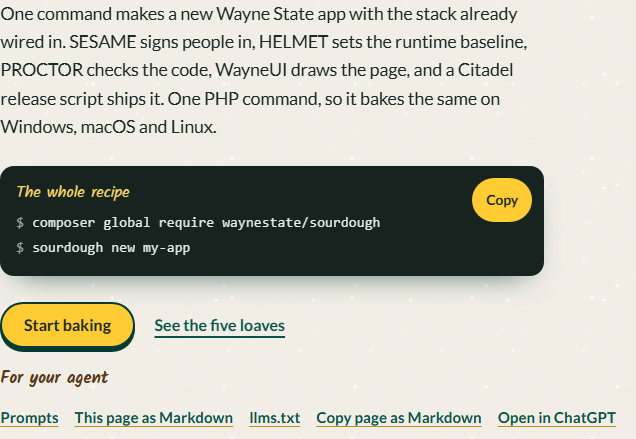

# Agent ready

The front page is written for people and for the coding agents they use. Every page of this site answers a client that asks for `text/markdown` with the same page as Markdown, and nothing on it phones home: the buttons only copy text or open the tool you picked.

## The agent's reading list

- [llms.txt](../llms.txt) lists every page of the site with its title and description, points at the prompts and the source, and names the stack's other agent entry points.
- [llms-full.txt](../llms-full.txt) holds the README and every page in one Markdown file.
- Each page has a Markdown twin beside it (`index.md` next to `index.html`), linked from the page head with `<link rel="alternate" type="text/markdown">`.

An agent that fetches `llms.txt` gets a map; it then fetches only the pages it needs and works from them instead of from memory.

## Recipes for your agent

The front page carries three prompts under [Recipes for your agent](../index.html#agents), ready for OpenCode, Claude Code, Codex CLI or ChatGPT. Each tells the agent what Sourdough put in the app and what it must leave alone, and each tells it to ask before it guesses.

### Recipe No. 1: Get started with Sourdough

Installs Sourdough, bakes a raw PHP app, fetches WayneUI's standalone file, serves it locally and runs the manifest check. The prompt points the agent at `llms.txt` first, then walks it through `composer global require waynestate/sourdough`, `sourdough new my-app --raw`, the WayneUI fetch, `composer install`, ADVISOR wiring, `php -S localhost:8000 -t public` and `sourdough manifest --check`.

### Recipe No. 2: Check what has drifted in a Sourdough app

Runs `sourdough manifest --check` in an app Sourdough baked, lists the managed files that changed since Sourdough wrote them, and proposes what to put back. It changes nothing, and seeded files never count as drift.

### Recipe No. 3: Bake a Laravel app with Sourdough

Installs Sourdough, bakes one of the three Laravel shapes (Blade, Blade with Vue islands or Inertia/Vue) with the oven the developer chooses, serves it locally and runs the manifest check. The prompt points the agent at `llms.txt` first, then walks it through `composer global require waynestate/sourdough`, `sourdough new my-app` with the shape and oven flags, `composer install`, `cp .env.example .env`, `php artisan key:generate`, `php artisan migrate`, `npm install` and `npm run build` for the Vue shapes, ADVISOR wiring, `php artisan serve` and `sourdough manifest --check`.

Copy a prompt from the front page, or open it straight in your tool of choice. The commands in a prompt must stay the commands in these docs: the agent-ready check fails a prompt that runs a command the docs do not.
