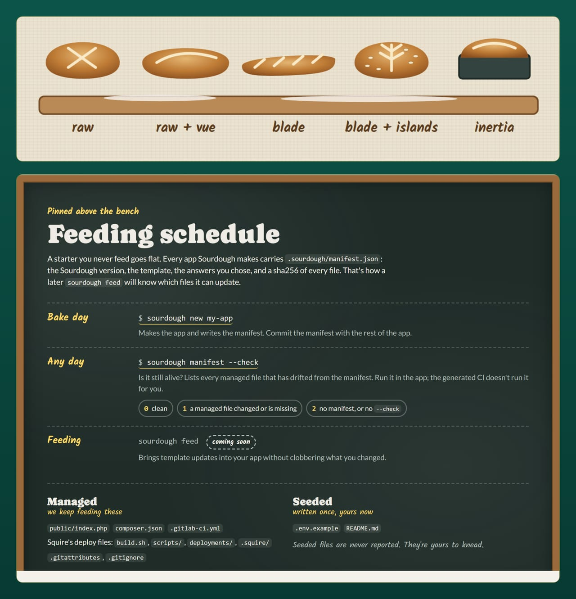
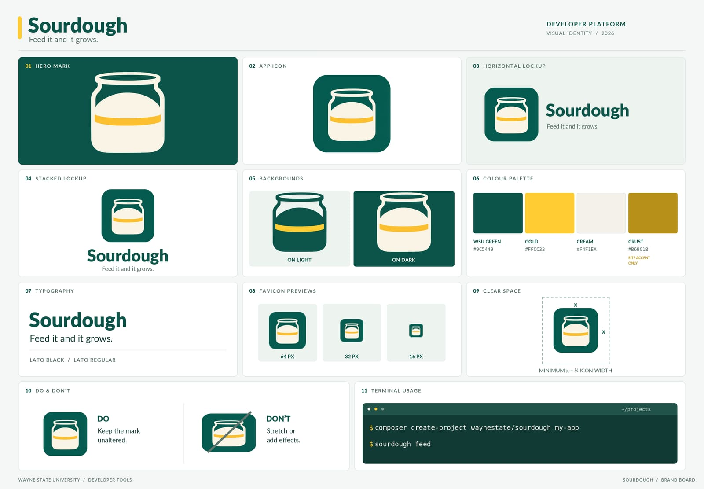

# CI

Sourdough's pipelines run one gate, `composer ci`, on both forges: the same command on GitLab and GitHub. This page covers what each pipeline runs, what green means, and where the pipelines should run. For what the gate contains, continue to [Testing](./testing.md).

> [!TIP]
> Strongly recommended: a git.wayne.edu instance runner.

## On GitLab

Preflight's `php-test` (PHP 8.3, 8.4, 8.5) and `composer-audit` components, plus a `composer-ci` job.

## On GitHub

`.github/workflows/ci.yml` calls Preflight's reusable workflow with `composer ci`.

## What green means

Green means `composer ci` passed on all three PHP versions on both.

## The smoke jobs on CI

On CI the smoke gate runs as one job per shape: `smoke` (matrix) on GitHub, `smoke-raw`, `smoke-raw-vue`, `smoke-blade`, `smoke-blade-vue` and `smoke-inertia` on GitLab. All are `allow_failure: true` until the lead has seen every shape green on CI once; flip them to blocking after that proof. The full recipe is in [Testing](./testing.md).

The `proof` job runs the whole [proof harness](../reference/proof.md) on GitLab: every shape and every oven, with the last release fed forward, and keeps the Last run table and every step log as an artifact. It never runs on a push: start it by hand from any pipeline, or from a pipeline schedule that sets `SOURDOUGH_PROOF` to `1`.

## On the bench

## The recipe card

## Related

- [Testing](./testing.md)
- [Same kitchen, many ovens](./ovens.md)
- [Wiring the stack in](./wiring-the-stack.md)
- [Maintaining](../maintaining.md)
