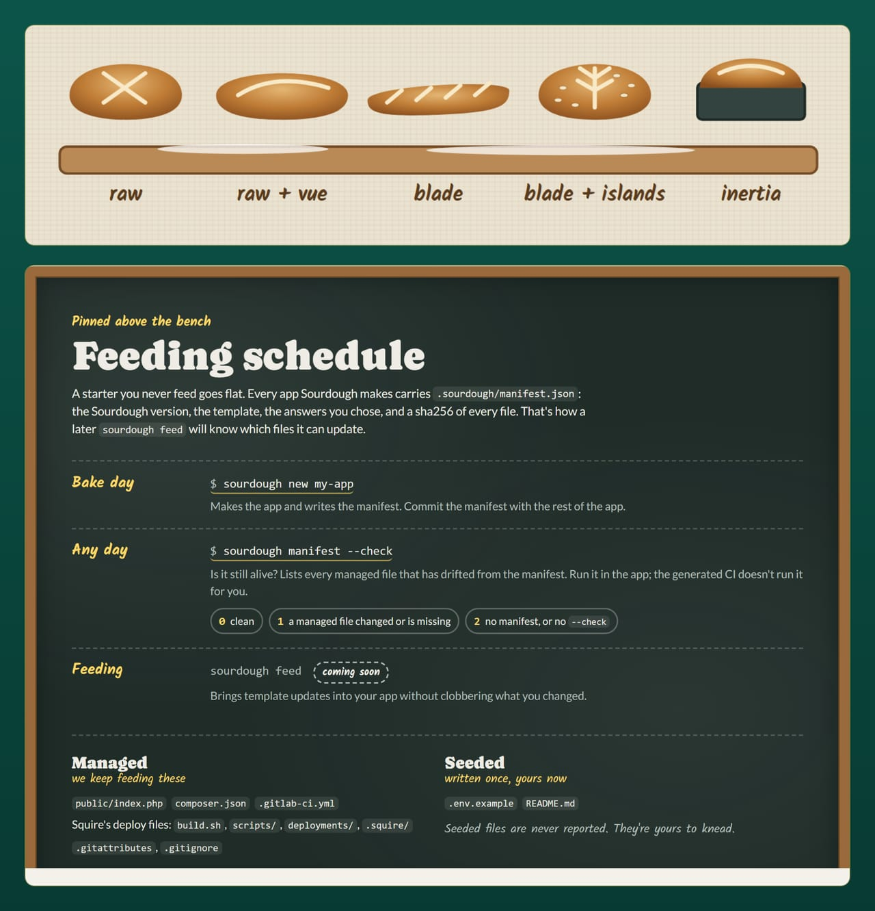

# Pick a shape

A starter in a jar is only potential until you give it a shape: pick the permutation below, then run `sourdough new` with the matching flags. If you would rather describe the app in a sentence and let a model plan it, continue to [Describe a plan](./describe-a-plan.md).



## The five permutations

| Flags | Permutation |
|---|---|
| (none) or `--raw` | Raw PHP with WayneUI's standalone path |
| `--raw --vue` | Raw PHP + Vue SPA over JSON |
| `--laravel` | Laravel + Blade |
| `--laravel --vue` | Laravel + Blade + Vue islands |
| `--laravel --inertia` (or `--inertia`) | Laravel + Inertia/Vue |

> [!WARNING]
> `--raw`, `--laravel`, `--laravel --vue` and `--inertia` generate in 0.1. The last permutation, `--raw --vue`, prints the plan and exits `1` with "not available in this release"; a later step adds it.

Run `sourdough new` with the flags for the row you want. `dir` is the directory to create the app in:

```bash tab="raw"
sourdough new my-app --raw
```

```bash tab="raw + vue"
sourdough new my-app --raw --vue
```

```bash tab="laravel"
sourdough new my-app --laravel
```

```bash tab="laravel + vue"
sourdough new my-app --laravel --vue
```

```bash tab="inertia"
sourdough new my-app --inertia
```

## The template directories

Each shape bakes from a directory in `templates/`:

| Template directory | Shape |
|---|---|
| `raw/` | Raw PHP with WayneUI's standalone path |
| `laravel-blade/` | Laravel + Blade |
| `laravel-blade-vue/` | Laravel + Blade + Vue islands |
| `laravel-inertia/` | Laravel + Inertia/Vue |

`squire/` holds Squire's exported deploy files. Squire owns them; Sourdough installs them as-is into every app and records them in the manifest, so you never edit them by hand.

The raw template also carries its own checks:

- Pinstripe's coding standard: `pint.json` (the per preset, with the fetched `public/wayne-ui.php` kept out and `vendor` excluded) and `phpstan.neon` (Pinstripe's raw preset, level 8 over `src/` and `public/`), with `waynestate/pinstripe` in require-dev and the extension-installer plugin allowed, and `lint`, `fix` and `analyse` scripts, so `composer ci` runs test, lint, analyse, proctor and audit in that order.
- An explicit `composer-ci` job in `.gitlab-ci.yml` (`composer install`, then `composer ci`), mirroring the Laravel overlay, so PROCTOR sees a `composer ci` in the pipeline instead of warning that no job runs it.
- `stubs/wayne-ui.php`, a static-analysis stub for the run-time WayneUI functions (`wsu_shell_start`, `wsu_shell_end`) that `phpstan.neon` scans through `scanFiles`.
- A front controller that answers `404` for any path but `/` (a short not-found page that keeps WayneUI's layout and links home) instead of rendering the home page for every URL; `/up` stays HELMET's and answers first.

## Oracle in every shape

Oracle is wired but dormant in every generated app. The settings `ORACLE_USERNAME`, `ORACLE_PASSWORD`, and either `ORACLE_TNS` or `ORACLE_HOST`, `ORACLE_PORT`, `ORACLE_SERVICE_NAME` ship commented out in `.env.example`; while they are empty, nothing connects and nothing errors. Once you fill them in, Laravel apps check the wiring with `php artisan oracle:check`, and raw PHP apps run queries through the `App\Oracle` helper, which takes values only as binds and answers mistakes with plain sentences. The command finds the check file where it lives: `oracle-check.php` at the app root, where Squire's Laravel layout ships it, first, then `deploy/oracle-check.php`.

## Related

- [Describe a plan](./describe-a-plan.md)
- [The manifest](./manifest.md)
