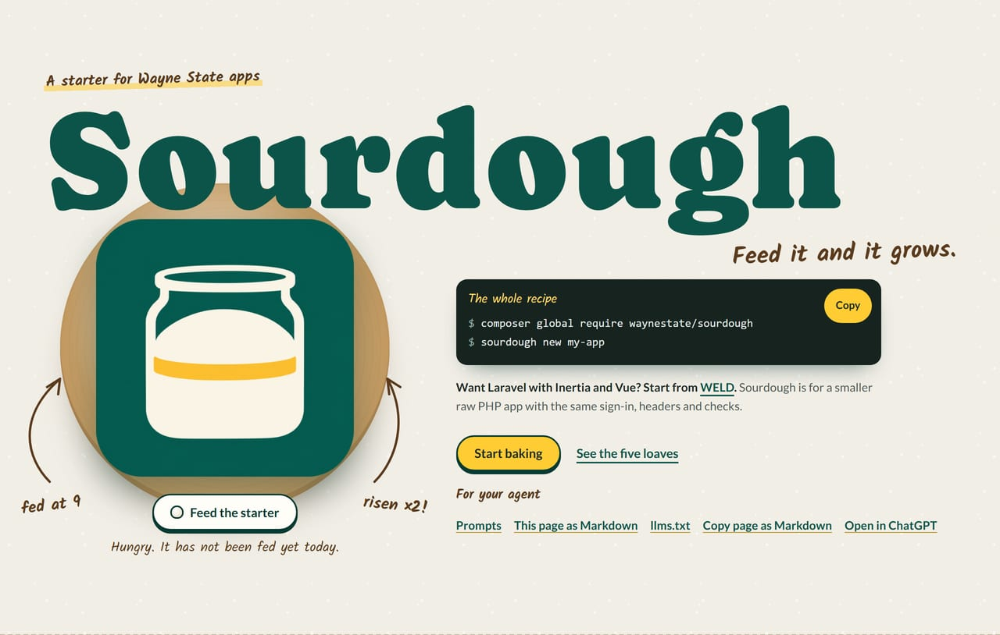
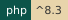
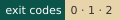
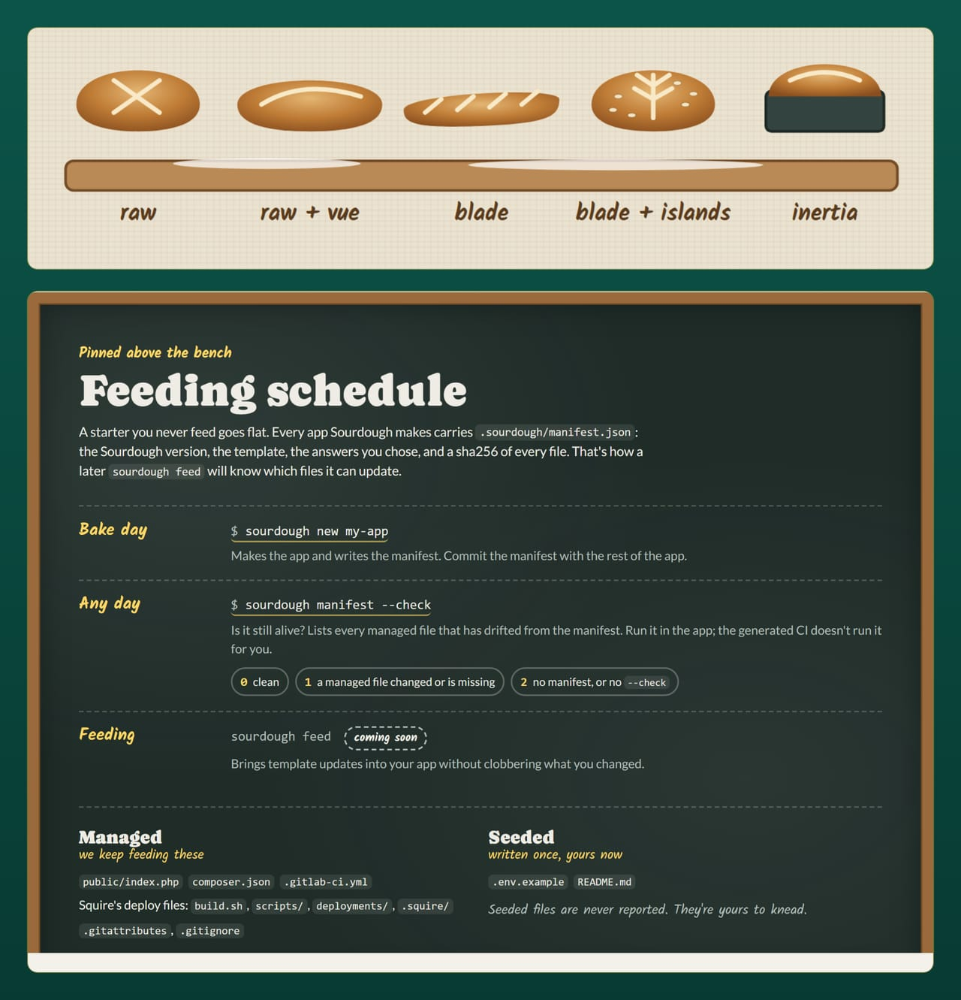
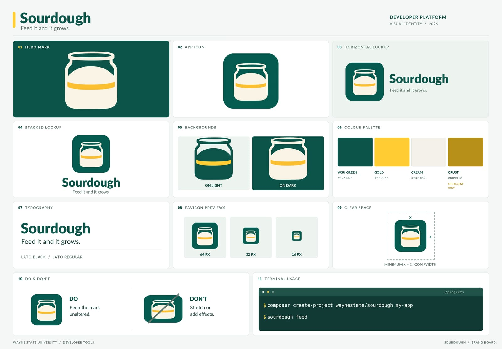

[](../index.html)

# Sourdough

   [](https://github.com/waynestate/sourdough/actions/workflows/ci.yml)

**Feed it and it grows.**

A starter you feed: `sourdough new` makes a Wayne State app with the stack already wired in. It starts every app shape: raw PHP, raw PHP with a Vue SPA, Laravel with Blade, Laravel with Blade and Vue islands, and Laravel with Inertia and Vue ([WELD](https://weld.apps.wayne.edu/) is that last shape already built). One command scaffolds a new app with WayneUI (the interface), SESAME (auth), HELMET (baseline runtime), Pinstripe (coding standard), PROCTOR (checks), the Preflight CI components, Squire's deploy files and ADVISOR (the stack's MCP server) already in place, with its PHP floor read from CREED's policy. It is one PHP command, so it works on Windows, macOS, and Linux.

Every loaf gets proofed before it ships. Checks: `composer ci` (the same command runs on GitLab and GitHub).



<sub>The proofing log from the front page: what goes into the tub when you run <code>sourdough new</code>, and the day-to-day check that keeps it alive.</sub>

## Install

```
composer global require waynestate/sourdough
```

After `composer global require`, the `sourdough` command lives in `composer global config bin-dir --absolute`; put that directory on your PATH. Or scaffold without installing, with `composer create-project waynestate/sourdough`. The full instructions are on [Install](install.md).

## First run

```
sourdough new my-app
```

Expected: exit code `0` (done), a `my-app` directory holding a Wayne State app with the stack wired in, and Next steps printed for it. Then run the app's own gate from inside `my-app/`:

```
composer ci
```

The step-by-step version is the [Quick start](guides/quick-start.md).

## Pick your path

- [Quick start](guides/quick-start.md): bake your first app and run its checks.
- [Install](install.md): what the machine needs, and the two ways to get Sourdough.
- [Adopt an existing app](guides/adopt.md): give an app Sourdough did not make a manifest, so `sourdough feed` can keep it current.
- [Reference](reference/commands.md): every command and option, the plan format, the templates.

## Status

Version 0.4.0 (2026-11-09), MIT license: Pinstripe 0.3 and ADVISOR 0.2 in every shape, Preflight 0.5.0 pins, Squire 0.10.3's kit, and `sourdough adopt` for apps Sourdough did not make. Pinstripe 0.3 fails an app that joins SQL from strings until it binds values instead: [Upgrading](upgrading.md#0-4-0-2026-11-09) has the fix. The [changelog](changelog.md) lists it all, and [Upgrading](upgrading.md) says what a feed brings. Agents: this site ships [llms.txt](https://sourdough.apps.wayne.edu/llms.txt) for LLM readers.

<details>
<summary>On the bench: the five loaves and the feeding schedule</summary>

</details>

<details>
<summary>The recipe card: Sourdough's brand board</summary>

</details>

## Same kitchen, many ovens

<a href="https://github.com/waynestate/wayne-ui"></a>
<a href="https://github.com/waynestate/creed"></a>
<a href="https://github.com/waynestate/proctor"></a>
<a href="https://github.com/waynestate/sesame"></a>
<a href="https://github.com/waynestate/helmet"></a>
<a href="https://github.com/waynestate/sourdough"></a>
<a href="https://github.com/waynestate/squire"></a>
<a href="https://github.com/waynestate/preflight"></a>
<a href="https://github.com/waynestate/pinstripe"></a>
<a href="https://github.com/waynestate/booster"></a>
<a href="https://github.com/waynestate/rollcall"></a>
<a href="https://git.wayne.edu/enterprise-apps/drawbridge"></a>
<a href="https://github.com/waynestate/advisor"></a>
<a href="https://github.com/waynestate/weld"></a>

<sub>Sourdough is one of the parts. Feed it, and it grows; just do not leave it on the counter over a long weekend.</sub>
