# Templates

Reference for the template directories under `templates/`: which directory bakes which shape, what each one carries, the Squire-owned deploy copy, and the rules the generator applies before it writes anything. Pick a shape first in [Pick a shape](../guides/shapes.md), then come back here for the exact values.

Five jars on the shelf, all five full in 0.1.



## The template directories

| Directory | Shape | Status in 0.1 |
|---|---|---|
| `raw/` | Raw PHP with WayneUI's standalone path | generates |
| `raw-vue/` | Raw PHP + Vue SPA over JSON, layered over `raw/` | generates |
| `laravel-blade/` | Laravel + Blade | generates |
| `laravel-blade-vue/` | Laravel + Blade + Vue islands | generates |
| `laravel-inertia/` | Laravel + Inertia/Vue | generates |
| `squire/` | Squire's exported deploy files, not a shape | installed as-is into every app |

The flags that select a shape:

| Flags | Permutation |
|---|---|
| (none) or `--raw` | Raw PHP with WayneUI's standalone path |
| `--raw --vue` | Raw PHP + Vue SPA over JSON |
| `--laravel` | Laravel + Blade |
| `--laravel --vue` | Laravel + Blade + Vue islands |
| `--laravel --inertia` (or `--inertia`) | Laravel + Inertia/Vue |

All five permutations generate in 0.1. `--raw --vue` is the raw PHP bake with a Vue 3 front end over it: PHP answers JSON under `/api/`, Vite builds the Vue app, and `src/Vite.php` loads it from the build or the dev server.

Bake commands for the five shapes:

```bash tab="raw"
sourdough new my-app --raw
```

```bash tab="raw + vue"
sourdough new my-app --raw --vue
```

```bash tab="laravel"
sourdough new my-app --laravel
```

```bash tab="laravel + vue"
sourdough new my-app --laravel --vue
```

```bash tab="inertia"
sourdough new my-app --inertia
```

## What each template carries

### raw/

- Pins WayneUI 2.0.8 (`https://wayneui.apps.wayne.edu/v2/releases/2.0.8/wayne-ui.php`) instead of fetching the floating `main` branch copy.
- Ships Pinstripe's coding standard: `pint.json` (the per preset, with the fetched `public/wayne-ui.php` kept out and `vendor` excluded) and `phpstan.neon` (Pinstripe's raw preset, level 8 over `src/` and `public/`), with `waynestate/pinstripe` in require-dev and the extension-installer plugin allowed.
- Ships `scripts` (`test`, `lint`, `fix`, `analyse`, `proctor`, `ci`) and `scripts-descriptions`, so a generated raw app can run its own gate locally with `composer ci`, which runs test, lint, analyse, proctor and audit in that order.
- Its `.gitlab-ci.yml` runs an explicit `composer-ci` job (`composer install`, then `composer ci`), mirroring the Laravel overlay, so PROCTOR sees a `composer ci` in the pipeline instead of warning that no job runs it.
- Ships `stubs/wayne-ui.php`, a static-analysis stub for the run-time WayneUI functions (`wsu_shell_start`, `wsu_shell_end`) that `phpstan.neon` scans through `scanFiles`, so `composer ci` in a freshly baked raw app no longer fails with function-not-found errors for functions that arrive only with the fetched `public/wayne-ui.php`.
- The front controller answers `404` for any path but `/` (a short not-found page that keeps WayneUI's layout and links home) instead of rendering the home page for every URL; `/up` stays HELMET's and answers first.
- Installs Squire's deploy files from `templates/squire/`: `build.sh`, `deployments/001-first-release.sh`, `scripts/release.sh`, `scripts/parity.sh`, `scripts/parity.ps1`, `health.php`, `public/up.php`, `docker-compose.squire.yml`, `.env.squire.example`, and the `.squire/` build context.
- Oracle: raw PHP apps run queries through the `App\Oracle` helper, which takes values only as binds and answers mistakes with plain sentences.

### raw-vue/

`sourdough new --raw --vue` copies `raw/` first, then `raw-vue/` over it, so the two raw shapes share the same Squire files, Pinstripe checks, Oracle helper, Playbook and ADVISOR wiring. The manifest records the template as `raw-vue`.

- `public/index.php` boots HELMET, the session and SESAME exactly as `raw/` does. Paths under `/api/` answer JSON: `/api/me` returns the signed-in user (`username` and `name`), an unknown endpoint is a JSON `404`, and a request without a session is a JSON `401` instead of a redirect to CAS. `/` sends the page that loads the Vue app; any other path sends the same page with a `404`, and Vue says the page does not exist.
- `src/Vite.php` prints the stylesheet, `modulepreload` and script tags for `resources/js/app.js` from `public/build/manifest.json` (imported chunks and their CSS included), each with HELMET's CSP nonce. While `npm run dev` runs, `public/hot` holds the dev server's origin and the helper points at it instead, and adds it to the CSP; with `APP_ENV=production` the hot file is ignored. `tests/ViteTest.php` covers both paths.
- `package.json` pins `@waynestate/wayne-ui-css` and `@waynestate/wayne-ui-vue` 2.0.8 exactly, as the Inertia shape does, with Vue 3 and Vite 6. `resources/css/app.css` imports WayneUI's layered `dist/wayne-ui.css`, and `resources/js/App.vue` draws the page with WayneUI's app bar, environment ribbon, cards and footer, served from the app's own origin (no CDN).
- `vite.config.js` builds into `public/build` with the manifest at its top, keeps `public/` (PHP's document root) out of the copy, and writes and removes `public/hot` around the dev server. `.gitignore` adds `/node_modules/`, `/public/build/` and `/public/hot`: Squire's release script runs `npm ci` and `npm run build` once `package-lock.json` is committed.
- Drops `stubs/wayne-ui.php` and `phpstan.neon`'s `scanFiles`: Vue draws the chrome, so there is no fetched `public/wayne-ui.php`.
- Its `.gitlab-ci.yml` adds a `frontend` job (`npm install`, `npm run build`) to the raw pipeline.

### laravel-blade/

- A fresh Laravel skeleton from Composer, the laravel-blade overlay, the stack packages, Squire's laravel deploy files and the manifest.
- Ships `app/Providers/AppServiceProvider.php` with `Schema::defaultStringLength(191)`, so string columns stay inside Citadel's MySQL 5.6 index limit (PROCTOR `mysql56-string-default`).
- The views read the signed-in user as an array (`$user['name']`), because SESAME's `Sesame::user()` returns an array, not an object.
- Next steps: `composer install`, `cp .env.example .env`, `php artisan key:generate`, `php artisan migrate`, `php artisan serve`.

### laravel-blade-vue/

- The Laravel + Blade bake under a front-end layer: Vite with the Vue plugin, a `resources/js/app.js` registry that mounts a Vue 3 app on every `[data-vue-island]` element, and a Counter island live on the dashboard view.
- Ships `tests/Feature/ExampleTest.php` with `$this->withoutVite()`, so `composer ci` in a freshly baked islands app does not fail on the missing Vite manifest before `npm run build` has run.
- Next steps: the Laravel + Blade steps plus `npm install` and `npm run build`.

### laravel-inertia/

- The same Laravel skeleton, the laravel-inertia overlay (Inertia pages rendered by Vue, Ziggy routes, the stack packages), Squire's laravel deploy files and the manifest.
- Inertia 3 on both sides: `inertiajs/inertia-laravel` `^3.0` and `@inertiajs/vue3` `^3.0`. The root view marks its `<title>` with `data-inertia`, Inertia hands the first page to Vue in a `<script type="application/json">` element (data, not code, so HELMET's CSP has nothing to admit), and no Axios: the pages talk through Inertia's own client. Add `axios` to `package.json` only when your own code imports it. `resources/js/app.ts` hands HELMET's per-request nonce (read from the pre-paint script) to Inertia's `nonce` option, so the progress bar's injected styles pass the CSP.
- Ships `AppServiceProvider` (string length 191 for Citadel's MySQL 5.6) and a `tests/TestCase.php` that writes a stub Vite manifest, so view tests boot without a build.
- The `.gitlab-ci.yml` carries the `ziggy` job: it regenerates `resources/js/ziggy.*` and fails on any diff, so the route list that ships inside the Vite bundle always matches the routes.
- The overlay allows `phpstan/extension-installer`; the appended SESAME and HELMET env keys ship commented out (except `SESAME_DRIVER=fake`) so package defaults hold instead of being overridden by empty values. `config/sesame.php` defaults `SESAME_FAKE_USERNAME` to `jane.doe`, so the fake driver has a non-empty username.
- Next steps: the Laravel + Blade steps plus `npm install` and `npm run build`.

## Shared wiring in every app

| Part | What lands in the app |
|---|---|
| Stack packages | HELMET `^0.3`, SESAME `^0.4`, PROCTOR `^0.6` (its `composer proctor` script is plain `proctor check`: PROCTOR 0.6 refuses `--policy` in CI and finds CREED's released policy in `vendor/waynestate/creed` by itself) |
| Playbook | `waynestate/playbook` in `require`, the VCS repository, `config.gitlab-domains` so Composer sends your token to git.wayne.edu, the seven setting names in `.env.example`, a `composer playbook` script that shows whether Playbook is installed, and a "WSU values (PLAYBOOK)" README section that explains how to get read access |
| ADVISOR | `waynestate/advisor` in `require-dev`, `.mcp.json` git-ignored (a client config starts a program for whoever opens the project), a README "ADVISOR" section; install with `php vendor/bin/advisor install --client=claude --write` |
| Preflight | `.gitlab-ci.yml` pins the Preflight CI components to the 0.1.4 release SHA (`79029cc2300702d0d450c42cc699e12af1b731f8`, with the tag in a trailing comment), because PROCTOR's `preflight-pinned` check (since 0.4) wants a 40-hex SHA |
| Oracle | wired but dormant: `ORACLE_USERNAME`, `ORACLE_PASSWORD`, and either `ORACLE_TNS` or `ORACLE_HOST`, `ORACLE_PORT`, `ORACLE_SERVICE_NAME` ship commented out in `.env.example`; while they are empty, nothing connects and nothing errors. Laravel apps check the wiring with `php artisan oracle:check` |
| Manifest | `.sourdough/manifest.json`: the Sourdough version, the template, the answers you chose, and a sha256 hash of every file, each marked `managed` or `seeded` |

Seeded files are `.env.example` and `README.md`: Sourdough wrote them once and you own them now. Managed files belong to Sourdough; the manifest is the record `sourdough feed` refreshes, merging in any edits you made. See [The manifest](../guides/manifest.md).

> [!NOTE]
> `--playbook` is kept for compatibility and changes nothing; `--no-playbook` skips the Playbook wiring and is for CI and automated tests only. WSU apps need Playbook. `--no-advisor` skips the ADVISOR wiring.

## The Squire-owned copy (`templates/squire/`)

The deploy files in your app come from Squire's exported copy, checked into this repository at `templates/squire/`: `raw/`, `laravel/`, `static/`, `vue/`, `catalog.json`, `manifest.json`. The copy is Squire 0.6.0's kit: its `scripts/release.sh` runs PROCTOR's deploy gate (`proctor gate`) right after `composer audit`, before the frontend build and the migrations, and writes the verdict to `storage/squire/proctor-gate.json` (`SQUIRE_PROCTOR_RECORD_DIR`), the baseline the next release is ratcheted against. Squire owns those files; Sourdough never hand-edits them, installs them as-is and records them in the manifest, so you never edit them by hand.

| Command | What it does |
|---|---|
| `composer squire-copy:sync` | rewrites the copy from the installed `waynestate/squire` package (dev dependency `^0.6`) |
| `composer squire-copy:check` | exits 1 when the committed copy has drifted; part of `composer ci` |

When Squire's templates change, regenerate the copy from a Squire checkout, then verify it:

```
php ../squire/bin/export-templates.php --to=../sourdough/templates/squire
php ../squire/bin/export-templates.php --to=../sourdough/templates/squire --check
```

Commit the refreshed copy with the Squire commit in the message, and add a CHANGELOG line.

## Rules the generator applies

From the best-practices notes, section 1 (Generating a project):

| Rule | What it requires | Stack today |
|---|---|---|
| Make the permutation an explicit, validated input | take the permutation from flags (`--raw`, `--vue`, `--laravel`, `--inertia`) and refuse combinations that make no sense, such as `--inertia` without `--laravel` | Documented; step 1 plans tests for every row and for the invalid combinations |
| Offer `--dry-run`, and make it write nothing | print the plan (files, packages, commands) and change nothing on disk | Documented; step 1 plans a test that `--dry-run` writes nothing |
| Refuse a non-empty target | refuse to generate into a directory that already has files; if overwriting is ever allowed, require a `--force` flag and prompt only when the session is interactive | Documented; there is no `--force` design yet |
| Use exit codes that scripts can rely on | 0 on success and distinct non-zero codes for the main failure modes, documented; PROCTOR uses 0 pass, 1 fail, 2 tool error | Not yet; pick one meaning for 2 across the stack before Sourdough ships |
| Keep output friendly to people and to machines | results to stdout and logs, warnings and errors to stderr, `--json` for the plan, color off when output is not a terminal, when `NO_COLOR` is set, or with `--no-color`, prompt only when stdin is a terminal, and `--no-input` so CI and agents never hang | Not yet |
| Test the generator on every permutation, in temp directories | generate each permutation into a temp directory and compare the result with a stored snapshot; test commands through a tester class rather than a real terminal | Documented; Laravel paths need the network, so their tests run in a pipeline job instead of the unit suite |
| Treat names, paths and templates as untrusted input | check `<dir>` and any app or vendor name against an allow-list before the value reaches a file name, a `composer.json` or a command line; refuse any write whose resolved path falls outside the target directory; keep templates as data: placeholder substitution only, with no code in a template running during generation | Enforced for names: `RawGenerator::assertValidName()` checks every name (letter or number first; then letters, numbers, spaces, dots, dashes and underscores; at most 63 characters) before generation touches the disk, and the test suite generates with hostile names (quotes, backslash, newline, NUL byte, `{{app_slug}}`, path traversal, 64 characters, empty, dashes only, leading dash or dot, a Unicode look-alike), asserting the exception and an absent or empty target dir. Paths stay inside the target by construction: the slug is `[a-z0-9-]` only and every write path is built under the target dir |
| Make the "new app" page and the CLI one engine | the page calls the same plan code as `sourdough new --dry-run --json`, shows the equivalent command, validates on the server with the rules above, and returns the same archive the CLI would write; a snapshot test compares the two | Documented for the page itself; Not yet for the shared-engine rule |

> [!NOTE]
> The untrusted-input rule exists because scaffolders have turned template content into code execution before: Backstage's scaffolder let anyone who could edit a registered template run code on the host (CVE-2023-35926, fixed in 1.15.0), and Copier refuses templates that use tasks, migrations or Jinja extensions unless the caller passes `--trust`.

## Related

- [Pick a shape](../guides/shapes.md)
- [Commands](./commands.md)
- [Plan format](./plan-format.md)
- [The manifest](../guides/manifest.md)
- [Troubleshooting](../troubleshooting.md)
